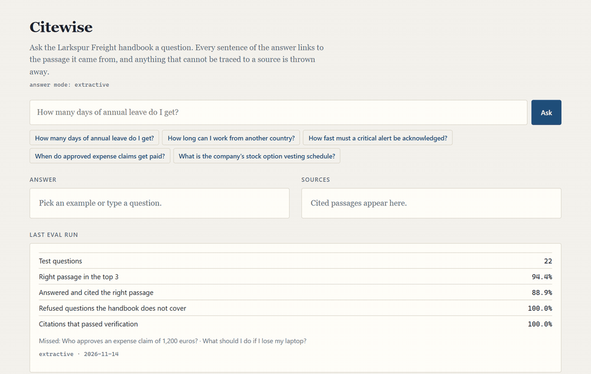

# Citewise

Question answering over company documents where every sentence of the answer carries a citation, and every citation is checked against the source before the user sees it.



## Why it exists

The usual failure of a document assistant is a confident answer with a reference that does not say what the answer claims. Citewise treats that as a bug to be caught in code, not in a prompt:

1. **Retrieve** the passages most relevant to the question.
2. **Draft** an answer as a list of claims, each with a source id and a verbatim quote.
3. **Verify** every claim: the source must be one that was retrieved, and the quote must appear in it word for word. Claims that fail are dropped.
4. **Refuse** when nothing survives, instead of answering from general knowledge.

Step 3 is plain string matching. It does not depend on the model behaving.

## Run it

```bash
npm install
npm run dev        # http://localhost:3460
```

No API key is needed. Without one, answers are built from the best-matching sentences of the retrieved passages (`extractive` mode). To draft answers with a model, point it at any OpenAI-compatible endpoint:

```bash
LLM_API_KEY=...  LLM_MODEL=...  LLM_BASE_URL=https://openrouter.ai/api/v1  npm run dev
```

The bundled corpus in `corpus/` is the handbook of a fictional company. Replace the markdown files with your own and restart.

## Evaluation

```bash
npm run eval
```

Runs 22 questions from `evals/testset.json` (18 answerable, 4 that the handbook does not cover) and writes `evals/last-report.json`, which the web page also displays. The command exits non-zero when retrieval or refusal accuracy drops below 0.8, so it can gate CI.

Current results in `extractive` mode:

| Metric | Result |
|---|---|
| Right passage in the top 3 | 94.4% |
| Answered and cited the right passage | 88.9% |
| Refused questions the handbook does not cover | 100% |
| Citations that passed verification | 100% |

The two misses are left in on purpose, because they show where keyword retrieval stops:

- "What should I do if I lose my laptop?" The handbook says "lost device", and keyword search does not connect the two.
- "Who approves an expense claim of 1,200 euros?" The answer needs a number compared against a range.

## How it is built

```
src/
  chunk.ts             markdown -> one chunk per heading, stable ids
  bm25.ts              BM25 index and search
  answer/
    types.ts           the Answerer port
    extractive.ts      no-model answerer
    llm.ts             OpenAI-compatible answerer
    verify.ts          citation check
  pipeline.ts          retrieve -> draft -> verify -> refuse
  server.ts            Express API and static page, per-IP rate limit
  eval.ts              eval runner
```

- Retrieval is BM25 with no external services, which keeps the demo free to run. The index sits behind one class, so it can be swapped for embeddings or a hybrid.
- The model sits behind the `Answerer` interface. The model path is covered by tests with a stubbed endpoint, including a fabricated quote that must be dropped. It has not been run against a live provider in this repository's CI.
- `npm run verify` runs the typecheck, the unit tests and the eval.

## Deploy

```bash
docker build -t citewise .
docker run -p 3460:3460 citewise
```

## License

MIT
